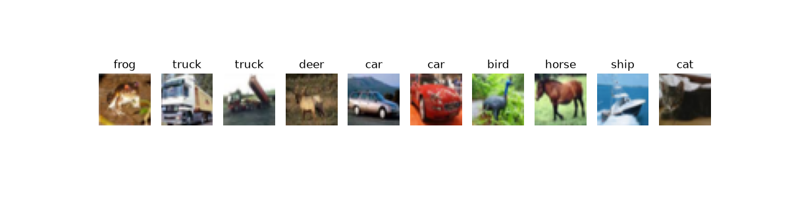
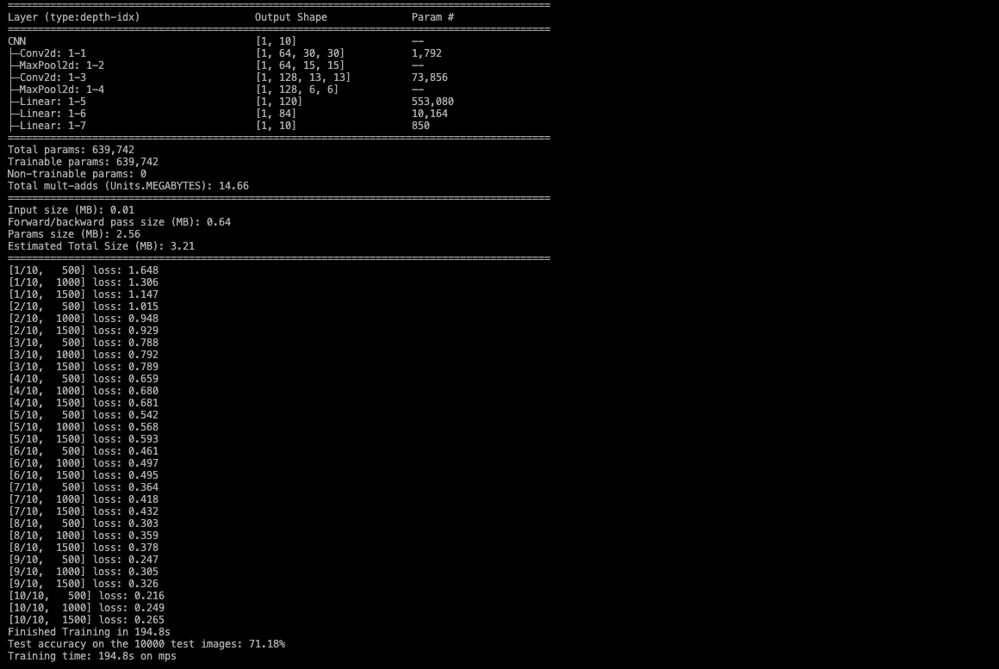
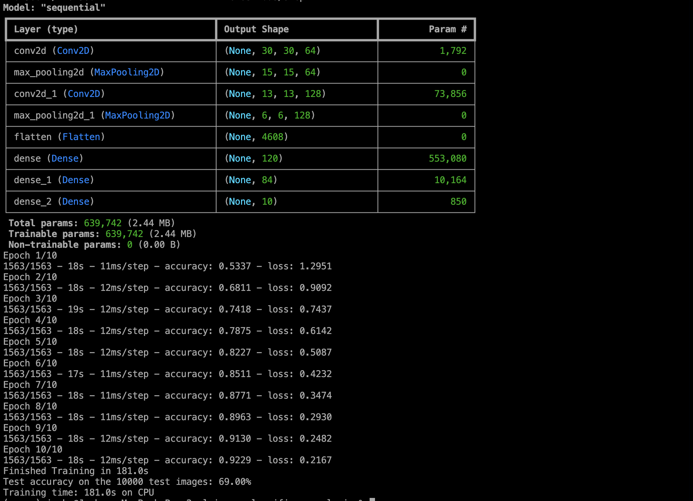
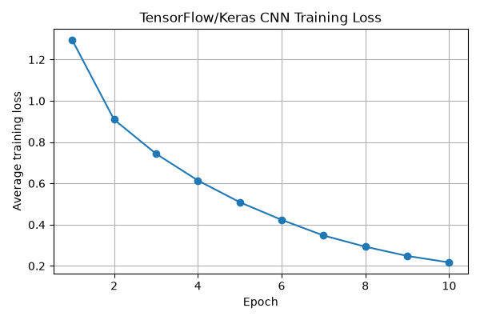
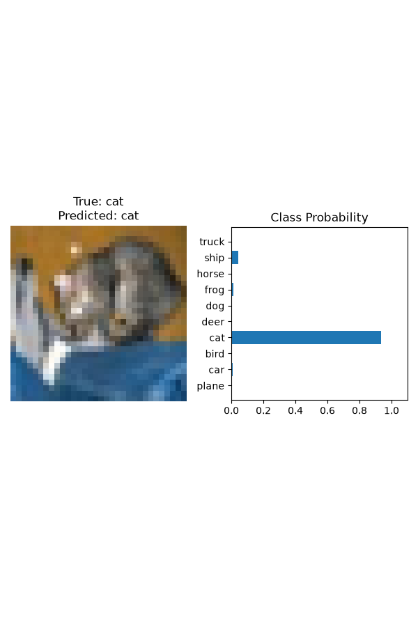

# CIFAR-10 Image Classification: PyTorch vs. TensorFlow/Keras
 


 
Comparing and documenting various methods of modeling and running an image classifier, using a CNN
 
---
 
## Table of Contents
 
- [Overview](#overview)
- [Results](#results)
- [Project Structure](#project-structure)
- [Getting Started](#getting-started)
- [Usage](#usage)
- [Model Architecture](#model-architecture)
- [Observations](#observations)
- [Next Step](#next-step)

- [Contact](#contact)
---
 
## Overview
 
I used popular ML frameworks PyTorch and Tensorflow to build two separate image classification models. I built a [CNN](https://docs.lib.purdue.edu/dissertations/AAI30685549/) (Convolutional Neural Network) in both models identical to one another. A CNN exercises the pieces that differ between them: convolution and pooling layers, flattening, a training loop vs. model.fit, loss functions, and optimizers. It’s also small enough to train in a few minutes on a laptop, so you could repeat runs across seeds.

- **Dataset:** CIFAR-10, 60,000 images, Split: 50k/10k, 10 Evenly Balanced Classes
- **Frameworks compared:** PyTorch vs. TensorFlow
- **Goal:** Strenghtened knowledge of both libraries, and utility of a Convolutional Neural Network

 
---
 
## Results

CIFAR-10, same 639,742-parameter CNN in both frameworks, 10 epochs, batch size 32, Adam (lr 0.001), seed 42.

**PyTorch Output**
 

**Tensor Flow Output**
 

------------

| | PyTorch | TensorFlow/Keras |
|---|---|---|
| Device | Apple GPU (MPS) | CPU |
| Training time (10 epochs) | 194.8s | 181.0s |
| Test accuracy | 71.18% | 69.00% |
| Final train loss | ~0.24 | 0.217 |
| Final train accuracy | not recorded | 92.29% |

> **Note:** Single run per framework, so the 2.2-point accuracy gap is within normal run-to-run variation. The two runs used different hardware, so training times are not a framework comparison.


 
-----
 

------
 
### Sample Prediction. (PyTorch)
 

 
---

### Sample Prediction. (TensorFlow)
 

 
---
 
## Project Structure
 
```
*Files names may not be exact*

/
├── pytorch_image_classifier/
│   ├── model_pyt.py
|   ├── cifar_cnn.pth
│   ├── [output files]
│   └── requirements.txt
├── tflow_keras_image_classifier/
│   ├── model_tf.py
|   ├── cifar_cnn.pth
│   ├── [output files]
│   └── requirements.txt
├── .gitignore
└── README.md
```
 
---
 
## Getting Started
 
### Installation
 
```bash
# Clone the repository
git clone https://github.com/[username]/[repo-name].git
cd [repo-name]
 
# Create and activate a virtual environment (one per framework)
cd [pytorch or tensorflow]
python3 -m venv .venv
source .venv/bin/activate
 
# Install dependencies
pip install -r requirements.txt
```
 
> The dataset downloads automatically on first run.
 
---
 
## Usage
 
```bash
# Train and evaluate a single model
python model.py
 
# Run multi-seed experiments
python experiments_pytorch.py --epochs 10 --seeds 0 1 2
```
 
**Output files:**
 
| File | Description |
|---|---|
| `cifar_cnn.pth` | Holds the model's weights and biases |
| `.png files` | Graphs and predictions |
 
---
 
## Model Architecture

A small convolutional neural network with two convolution and max-pooling blocks followed by three fully connected layers, implemented identically in PyTorch and TensorFlow/Keras.

| Layer | Output Shape | Parameters |
|---|---|---|
| Input (RGB image) | 32 × 32 × 3 | 0 |
| Conv2D (64 filters, 3×3, ReLU) | 30 × 30 × 64 | 1,792 |
| MaxPool (2×2) | 15 × 15 × 64 | 0 |
| Conv2D (128 filters, 3×3, ReLU) | 13 × 13 × 128 | 73,856 |
| MaxPool (2×2) | 6 × 6 × 128 | 0 |
| Flatten | 4,608 | 0 |
| Dense (120, ReLU) | 120 | 553,080 |
| Dense (84, ReLU) | 84 | 10,164 |
| Dense (10, softmax) | 10 | 850 |
| **Total** | | **639,742** |

**Training setup:** Adam optimizer, learning rate 0.001, batch size 32, 10 epochs, seed 42. Images are normalized to the range [-1, 1]. The loss is negative log-likelihood (PyTorch, on log-softmax outputs) and sparse categorical cross-entropy (Keras, on softmax outputs), which are mathematically equivalent.
 
---
 
## Observations
 
 - [**Overfitting:**](https://aws.amazon.com/what-is/overfitting/) TensorFlow hit 92.3% training accuracy but only 69.0% test accuracy, a gap of about 23 points. PyTorch’s final loss is similar, so it very likely overfits the same way. Small datasets like the one I used don't contain enough data to for represnting all possible input values with accuracy.

- **CPU vs GPU:** Surprisingly, for my Mac Processor, time to train was nearly identical. Likely that the small size of the data is the factor here, so the difference will not be seen with something so small.


- **Small Data on a Small Processor:**  In short, with the rudementary setup, there is not much room to check for error between the models. 
---
 
## Next Step
- Find stronger processors hosted online, to be able to harness greating training on larger sets to find potnetial nuances and niche differences.
- Running on Google's 'CoLab' would give opportunity to work on NVIDIA GPUs with CUDA cores.

---
 
 

 
## Contact

**Joshua Chauhan** · [Email](mailto:chauhaj@purdue.edu) · [LinkedIn](https://linkedin.com/in/joshua-chauhan) · [GitHub](https://github.com/josh-chauhan)
 


